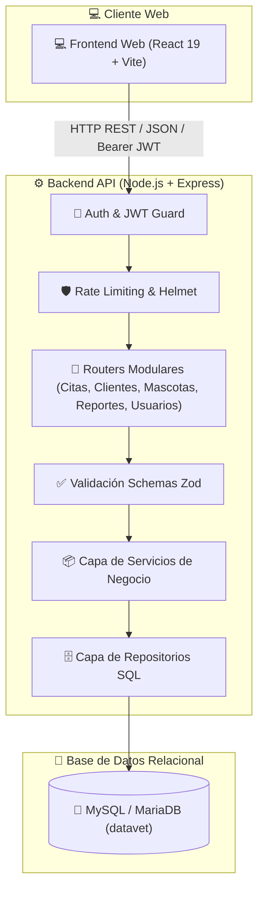

# 🐾 DATAVET — Sistema Integral de Gestión Médica & Clínica Veterinaria

[](https://nodejs.org/)
[](https://expressjs.com/)
[](https://react.dev/)
[](https://www.mysql.com/)
[](https://tailwindcss.com/)
[](https://jwt.io/)

**DATAVET** es una plataforma clínica y administrativa diseñada para optimizar los procesos de atención veterinaria: gestión de expedientes clínicos de pacientes, agenda de citas en tiempo real, monitoreo en sala de espera, administración de trabajadores con control de acceso por roles (RBAC), y generación de métricas e informes operativos.

---

## 📑 Tabla de Contenidos

1. [Arquitectura del Sistema](#-arquitectura-del-sistema)
2. [Estructura del Proyecto](#-estructura-del-proyecto)
3. [Módulos Principales](#-módulos-principales)
4. [Roles de Usuario y Permisos (RBAC)](#-roles-de-usuario-y-permisos-rbac)
5. [Cuentas Demo Preconfiguradas](#-cuentas-demo-preconfiguradas)
6. [Requisitos Previos](#-requisitos-previos)
7. [Instalación y Puesta en Marcha](#-instalación-y-puesta-en-marcha)
   - [1. Base de Datos (MySQL / MariaDB)](#1-base-de-datos)
   - [2. Backend (API REST Express)](#2-backend-api-rest)
   - [3. Frontend Web (React + Vite + Tailwind)](#3-frontend-web)
8. [Catálogo de Endpoints de la API REST](#-catálogo-de-endpoints-de-la-api-rest)
9. [Seguridad y Buenas Prácticas](#-seguridad-y-buenas-prácticas)

---

## 🏛️ Arquitectura del Sistema

El ecosistema está construido bajo una arquitectura cliente-servidor desacoplada:



---

## 📁 Estructura del Proyecto

```text
datavet/
├── backend/                   # Servidor Express.js (API REST)
│   ├── src/
│   │   ├── config/            # Variables de entorno y configuraciones (env.js)
│   │   ├── db/                # Pool de conexiones MySQL y transacciones atómicas
│   │   ├── errors/            # Clases de error HTTP tipadas
│   │   ├── middlewares/       # Auth JWT, RBAC y error handler global
│   │   ├── modules/
│   │   │   ├── auth/          # Login, tokens, verificación de cédula y contraseñas
│   │   │   ├── citas/         # Agenda diaria, filtros, estados y solapamiento
│   │   │   ├── clientes/      # Registro unificado (propietario + mascotas)
│   │   │   ├── mascotas/      # Expedientes, consultas médicas e historias clínicas
│   │   │   ├── reportes/      # Resumen ejecutivo, volumen de citas y top médicos
│   │   │   └── usuarios/      # CRUD de trabajadores, roles y contraseñas
│   │   ├── routes/            # Índice de enrutamiento (/api/*)
│   │   ├── app.js             # Configuración de Express, CORS, Helmet y límites
│   │   └── server.js          # Entrada del servidor y verificación de BD
│   ├── .env.example           # Plantilla de variables de entorno del backend
│   └── package.json
│
├── frontend/                  # Panel Web Administrativo (React 19 + Vite)
│   ├── src/
│   │   ├── components/        # Layout con barra lateral, PrivateRoute, Spinners
│   │   ├── context/           # AuthContext (persistencia de sesión en localStorage)
│   │   ├── pages/
│   │   │   ├── LoginPage.jsx        # Acceso con cédula y contraseña
│   │   │   ├── DashboardPage.jsx    # Resumen operativo, estadísticas y accesos directos
│   │   │   ├── AgendaPage.jsx       # Calendario de citas y modal de agendamiento
│   │   │   ├── MonitoreoPage.jsx    # Flujo en vivo de pacientes en sala de espera
│   │   │   ├── PacientesPage.jsx    # Directorio de clientes con chips de especies
│   │   │   ├── FichaMascotaPage.jsx # Expediente clínico, diagnósticos y tratamientos
│   │   │   ├── RegistrarPage.jsx    # Asistente por pasos (Wizard) Propietario + Mascotas
│   │   │   ├── ReportesPage.jsx     # Gráficos de concurrencia y métricas operativas
│   │   │   ├── UsuariosPage.jsx     # Gestión de trabajadores, contraseñas y roles
│   │   │   └── UnauthorizedPage.jsx # Pantalla de bloqueo 403
│   │   ├── services/          # Cliente Axios centralizado con interceptores
│   │   ├── App.jsx            # Definición de rutas protegidas
│   │   └── main.jsx
│   ├── .env                   # VITE_API_URL configurado a http://localhost:3000/api
│   └── package.json
│
└── database/                  # Scripts SQL y esquemas relacionales
    └── base de datos Datavet.sql # Script completo DDL/DML para MySQL/MariaDB
```

---

## 🧩 Módulos Principales

### 1. 📋 Registro Unificado de Pacientes (Wizard en 3 Pasos)
- Alta de clientes y hasta 10 mascotas en una **única transacción atómica** (`withTransaction`). Si falla el registro de una mascota, se revierte toda la operación para evitar inconsistencias.
- Apertura automática de la `historia_clinica` para cada mascota registrada.

### 2. 📅 Agenda Diaria & Control de Solapamiento
- Agendamiento con validación médica: previene citas en fechas/horas pasadas o solapadas para el mismo profesional veterinario.
- Mapeo semántico de estados de consulta: `pendiente`, `atendida` y `cancelada`.

### 3. 🩺 Expediente & Ficha Clínica
- Línea de tiempo detallada con consultas médicas (`consultas_medicas`), síntomas, diagnóstico, prescripción de tratamientos y observaciones.
- Historial de agendamientos previos de la mascota y datos de contacto rápido del propietario.

### 4. 📺 Monitoreo en Tiempo Real
- Pantalla tipo sala de espera que actualiza automáticamente cada 30 segundos sin recargar la página.
- Gestión ágil del flujo de pacientes: paso a consulta y marcado como atendido con 1 clic.

### 5. 📊 Reportes Clínicos y Métricas
- Gráficos de concurrencia por día y por día de la semana.
- Gráfico proporcional tipo Donut para distribución de citas.
- Ranking de veterinario más activo y desglose por especies atendidas.

### 6. 👥 Gestión de Personal y Cuentas
- Registro de nuevos trabajadores con validación de documento.
- Creación automática de ficha profesional en la tabla `veterinarios` para usuarios con dicho rol.
- Restablecimiento seguro de contraseñas hasheadas con `bcryptjs` (cost factor 12) y activación/desactivación de cuentas.

---

## 🛡️ Roles de Usuario y Permisos (RBAC)

El sistema implementa control de acceso basado en roles tanto en el frontend (`PrivateRoute`) como en el backend (`requireRole`):

| Módulo / Funcionalidad | Administrador (`admin`) | Recepcionista (`recepcionista`) | Veterinario (`veterinario`) |
|---|:---:|:---:|:---:|
| **Dashboard y Resumen** | ✅ | ✅ | ✅ |
| **Consultar Agenda** | ✅ | ✅ | ✅ |
| **Agendar Citas** | ✅ | ✅ | ❌ |
| **Monitoreo en Sala** | ✅ | ✅ | ✅ |
| **Ver Expedientes / Pacientes** | ✅ | ✅ | ✅ |
| **Registrar Consulta Médica** | ✅ | ❌ | ✅ |
| **Registrar Clientes / Mascotas** | ✅ | ✅ | ❌ |
| **Métricas e Informes** | ✅ | ❌ | ❌ |
| **Gestión de Trabajadores** | ✅ | ❌ | ❌ |

---

## 🔑 Cuentas Demo Preconfiguradas

La base de datos cuenta con los siguientes perfiles precargados para pruebas:

| Rol | Nombre | Cédula | Contraseña |
|---|---|---|---|
| **Administrador** | Juan Torres | `666666666` | `123456` |
| **Recepción** | Laura Martinez | `1` | `test1234` |
| **Veterinario** | Carlos Ramirez | `2` | `test1234` |
| **Veterinario** | Ana Rodriguez | `3` | `test1234` |

---

## ⚙️ Requisitos Previos

- **Node.js**: versión `20.x` o superior
- **npm**: versión `10.x` o superior
- **MySQL Server** o **MariaDB**: versión `8.0+` / `10.5+`
- Herramienta de gestión de BD (opcional): MySQL Workbench, HeidiSQL, DBeaver o phpMyAdmin

---

## 🚀 Instalación y Puesta en Marcha

### 1. Base de Datos

1. Abre tu gestor de base de datos preferido (HeidiSQL, MySQL Workbench o terminal).
2. Ejecuta el archivo SQL ubicado en `database/base de datos Datavet.sql`. Esto creará la base de datos `datavet` junto con todas sus tablas, restricciones y datos iniciales.
3. Asegúrate de que el servicio de MySQL esté corriendo en el puerto estándar `3306`.

---

### 2. Backend (API REST)

1. Abre una terminal y navega al directorio del backend:
   ```bash
   cd backend
   ```
2. Instala las dependencias:
   ```bash
   npm install
   ```
3. Configura las variables de entorno en `backend/.env` (puedes basarte en `.env.example`):
   ```ini
   PORT=3000
   NODE_ENV=development

   # Base de datos MySQL
   DB_HOST=localhost
   DB_PORT=3306
   DB_USER=root
   DB_PASSWORD=TU_CONTRASEÑA_MYSQL
   DB_NAME=datavet

   # Seguridad JWT
   JWT_SECRET=datavet_jwt_super_secreto_2024_xK9mP2qL8nR5vT3w
   JWT_EXPIRES_IN=8h

   # Seguridad CORS
   CORS_ORIGINS=http://localhost:5173
   TRUST_PROXY=false
   JSON_BODY_LIMIT=100kb
   RATE_LIMIT_WINDOW_MS=900000
   RATE_LIMIT_MAX=100
   AUTH_RATE_LIMIT_MAX=20
   ```
4. Inicia el servidor en modo desarrollo con recarga automática:
   ```bash
   npm run dev
   ```
   *Deberás observar:*
   ```text
   ✅ Conexión a MySQL establecida correctamente.
   🚀 DATAVET backend corriendo en http://localhost:3000
   ```

---

### 3. Frontend Web

1. Abre una nueva terminal y navega a la carpeta del frontend:
   ```bash
   cd frontend
   ```
2. Instala las dependencias:
   ```bash
   npm install
   ```
3. Verifica que el archivo `frontend/.env` tenga la URL base del backend:
   ```ini
   VITE_API_URL=http://localhost:3000/api
   ```
4. Inicia la aplicación web con Vite:
   ```bash
   npm run dev
   ```
5. Abre tu navegador en la URL indicada (habitualmente `http://localhost:5173`).

---

## 📡 Catálogo de Endpoints de la API REST

Todos los endpoints (salvo los públicos) requieren el encabezado:  
`Authorization: Bearer <TOKEN_JWT>`

### 🔐 Autenticación (`/api/auth`)
| Método | Endpoint | Acceso | Descripción |
|---|---|---|---|
| `POST` | `/api/auth/login` | Público | Autenticación con cédula y contraseña. Retorna JWT y usuario. |
| `POST` | `/api/auth/recuperar-password` | Público | Solicitud de recuperación de contraseña. |
| `POST` | `/api/auth/verificar-cedula` | Público | Comprueba existencia de documento para cambio de clave. |
| `POST` | `/api/auth/cambiar-password` | Público | Actualización de contraseña mediante cédula. |
| `GET` | `/api/auth/veterinarios` | Autenticado | Lista los profesionales médicos veterinarios activos. |

### 📅 Citas y Agenda (`/api/citas`)
| Método | Endpoint | Acceso | Descripción |
|---|---|---|---|
| `GET` | `/api/citas` | Autenticado | Lista citas filtrando por `?fecha=YYYY-MM-DD` y `?estado=`. |
| `GET` | `/api/citas/dashboard-stats`| Autenticado | Retorna conteos generales para las tarjetas del Dashboard. |
| `POST` | `/api/citas` | Admin / Recepcionista | Agenda una nueva cita médica con chequeo de solapamiento. |
| `PATCH`| `/api/citas/:id/estado` | Todos los roles | Modifica el estado de una cita (`pendiente`, `atendida`, `cancelada`). |
| `DELETE`| `/api/citas/:id` | Admin / Recepcionista | Elimina una cita de la agenda. |

### 👥 Clientes y Mascotas (`/api/clientes`)
| Método | Endpoint | Acceso | Descripción |
|---|---|---|---|
| `GET` | `/api/clientes` | Autenticado | Lista todos los propietarios junto con sus mascotas asignadas. |
| `POST` | `/api/clientes/registrar` | Admin / Recepcionista | Transacción unificada: registra cliente, mascotas e historia clínica. |

### 🐾 Mascotas y Consultas Médicas (`/api/mascotas`)
| Método | Endpoint | Acceso | Descripción |
|---|---|---|---|
| `GET` | `/api/mascotas/:id` | Autenticado | Detalle completo de la mascota, dueño, citas y consultas previas. |
| `POST` | `/api/mascotas/:id/historial` | Admin / Veterinario | Registra una consulta clínica, diagnóstico y tratamiento. |
| `GET` | `/api/mascotas/cliente/:clienteId` | Autenticado | Lista las mascotas que pertenecen a un cliente específico. |

### 📈 Reportes e Informes (`/api/reportes`)
| Método | Endpoint | Acceso | Descripción |
|---|---|---|---|
| `GET` | `/api/reportes/resumen` | Solo Administrador | Totales de clientes, citas por estado, top especies y top médico. |
| `GET` | `/api/reportes/citas-por-dia` | Solo Administrador | Distribución de volumen de citas por día (`?dias=30`). |
| `GET` | `/api/reportes/citas-por-dia-semana` | Solo Administrador | Concurrencia histórica agrupada por día de la semana. |

### 🛠️ Gestión de Usuarios (`/api/usuarios`)
| Método | Endpoint | Acceso | Descripción |
|---|---|---|---|
| `GET` | `/api/usuarios` | Solo Administrador | Lista las cuentas de trabajadores registradas. |
| `POST` | `/api/usuarios` | Solo Administrador | Crea un nuevo trabajador y sincroniza su rol. |
| `PATCH`| `/api/usuarios/:id/estado` | Solo Administrador | Activa o desactiva el acceso de una cuenta. |
| `PUT` | `/api/usuarios/:id/password` | Solo Administrador | Asigna una nueva contraseña cifrada a un trabajador. |

---

## 🔒 Seguridad y Buenas Prácticas

- **Cifrado de Contraseñas:** Se utiliza `bcryptjs` con salt rounds = 12 para almacenar hashes seguros en la base de datos.
- **Protección de Cabeceras HTTP:** Integración de `helmet` para prevenir ataques de Cross-Site Scripting (XSS), Clickjacking y sniffing de MIME types.
- **Limitación de Peticiones (Rate Limiting):** Ventana de protección de fuerza bruta sobre rutas críticas (`/api/auth`) y limitador general contra ataques de denegación de servicio (DoS).
- **Control Estricto de Origen (CORS):** Filtro parametrizable en `.env` para limitar el acceso únicamente a los clientes web y móviles autorizados.
- **Trazabilidad (`X-Request-Id`):** Cada petición entrante recibe un identificador UUID único para seguimiento y depuración de incidentes en los logs del servidor.
- **Principio de Mínimo Privilegio:** Restricción de rutas mediante middlewares de rol en Express y componentes de ruta privada en React.

---

## 👨‍💻 Autoría y Licencia

Desarrollado para la gestión y modernización de clínicas veterinarias.  
Código distribuido bajo fines académicos y profesionales.
